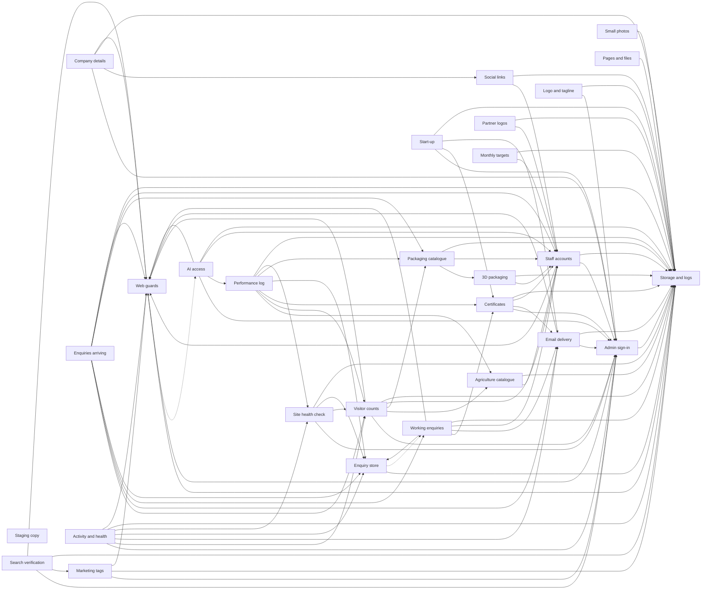

# The boxes and their wiring

Generated by `npm run boxes`. Edit `boxes/parts/`, not this file. For a map you can click, open `boxes/map.html`.

## How the server boxes are wired

Each arrow means "is given something by". The order is the order `server.js` plugs them in.

## Foundations

| Box | What it does | Connects to | Routes | Files |
| --- | --- | --- | --- | --- |
| **admin-sign-in** | The admin password and sessions, and the guard every admin-only route stands behind. | admin-panel, site-basics, staff-ui, storage, web-guards | 4 | 3 |
| **email** | The mail account the site sends from, and sendEmail, which every box that writes to someone goes through. | admin-panel, admin-sign-in, admin-tools, staff-ui, staging, storage, web-guards | 2 | 3 |
| **image-upload** | Makes an uploaded picture safe and small: everything, SVG included, is redrawn as WebP. | nothing | 0 | 1 |
| **site-basics** | Small shared facts: who is calling, what counts as a bot, the site address, clean form text. | nothing | 0 | 1 |
| **staff-accounts** | Who may sign in to the workspaces, with which role, and the guards the staff routes stand behind. | admin-sign-in, enquiry-work, site-basics, site-shell, staff-ui, storage, web-guards | 6 | 8 |
| **staging** | The password-protected copy of the site: kept out of search engines and never mails real people. | nothing | 0 | 1 |
| **startup** | What happens once when the server really starts: a masked settings summary, safety checks, listening. | admin-sign-in, certificates, email, storage | 0 | 1 |
| **static-site** | Serves the built pages and uploads, sets how long browsers keep them, and answers the 404 and any server error. | storage | 1 | 2 |
| **storage** | Where everything is kept: the data and upload folders, safe file writes, the audit log and the error log. | site-basics | 0 | 1 |
| **web-guards** | What stands in front of every request: one site address, security headers, allowed origins, rate limits. | ai-access, storage | 0 | 2 |
| **wiring** | Connects every box. server.js plugs them in one line at a time, the board records what each was given, and the boxes tool saves and checks the map. | nothing | 0 | 4 |

## What the admin looks after

| Box | What it does | Connects to | Routes | Files |
| --- | --- | --- | --- | --- |
| **admin-panel** | The admin page: its sign-in, sections, and the overview of how the site is set up. | admin-sign-in, admin-tools, ai-access, branding, certificates, contact, email, marketing-tags, product-pages, site-shell, staff-accounts, staff-ui | 0 | 5 |
| **admin-tools** | The admin activity log, a test email, the site health card and the overview counts. | admin-sign-in, analytics, email, lead-store, site-health, staff-ui, storage, web-guards | 7 | 3 |
| **branding** | The logo and tagline every page shows. | admin-panel, admin-sign-in, image-upload, staff-ui, storage | 3 | 3 |
| **certificates** | Certifications with proof: the file, validity, expiry reminders, and the list on the public pages. | admin-panel, admin-sign-in, email, site-basics, site-data, site-shell, staff-accounts, staff-ui, storage | 4 | 7 |
| **contact** | The address, emails and phone numbers. Phone numbers reach a visitor only when they press a call or WhatsApp button. | admin-panel, admin-sign-in, site-basics, site-data, site-shell, social-links, staff-ui, storage, web-guards | 3 | 8 |
| **marketing-tags** | The optional Google Analytics and Ads tags. Nothing from Google loads until an ID is saved. | admin-panel, admin-sign-in, search-verification, staff-ui, staging, storage, web-guards | 3 | 4 |
| **search-verification** | Proves to Google and others that the site is ours. | admin-sign-in, marketing-tags, storage, web-guards | 3 | 1 |

## Catalogues

| Box | What it does | Connects to | Routes | Files |
| --- | --- | --- | --- | --- |
| **agri-catalogue** | The agriculture products: the public pages, the team editing them, photos and specifications. | agri-panel, certificates, contact, enquiries, facts-spreadsheet, image-upload, manager-reports, product-pages, seo, site-data, site-shell, staff-accounts, staff-ui, storage, thumbs | 7 | 7 |
| **facts-spreadsheet** | The catalogue facts as a spreadsheet: download, fill in, import with a preview, saved whole or not at all. | agri-catalogue, packaging-catalogue, staff-ui | 0 | 2 |
| **packaging-3d** | A packaging product in 3D at its own measurements: it folds, opens and lays flat, wears the visitor's logo or artwork, and shows on the website only when both the packaging team and the manager have switched it on. | packaging-catalogue, staff-accounts, staff-ui, storage | 3 | 8 |
| **packaging-catalogue** | The packaging products: rules, photos, sizes, minimums, prices, the public catalogue and the team editing it. | agri-catalogue, contact, enquiries, facts-spreadsheet, manager-reports, mockup-studio, packaging-3d, packing-list, product-pages, seo, site-data, site-shell, staff-accounts, staff-ui, storage, thumbs | 8 | 14 |
| **partners** | The partner logos on the home page, looked after by the marketing teams. | staff-accounts, staff-ui, storage | 3 | 3 |
| **product-pages** | The product card, grid, details panel and page that both catalogues share, and the facts each one shows. | certificates, enquiries, mockup-studio, packaging-3d, packaging-catalogue, site-data, site-shell, thumbs | 0 | 6 |
| **social-links** | The social pages and WhatsApp link. The public list leaves the WhatsApp number out. | staff-accounts, staff-ui, storage | 3 | 5 |
| **thumbs** | Small copies of catalogue photos, made once and kept. | storage | 1 | 2 |

## Enquiries and sales

| Box | What it does | Connects to | Routes | Files |
| --- | --- | --- | --- | --- |
| **enquiries** | A buyer sends an enquiry: it is checked, saved before any email is tried, routed to its team, and acknowledged. | analytics, email, enquiry-work, lead-store, packaging-catalogue, site-data, staff-accounts, storage, web-guards | 1 | 5 |
| **enquiry-work** | The inboxes, pipeline, replies, quotes, buyers and files, for the teams and the manager. | agri-catalogue, branding, certificates, contact, email, enquiries, lead-store, packaging-catalogue, packing-list, site-basics, staff-accounts, staff-ui, storage, web-guards | 9 | 15 |
| **lead-store** | Where enquiries are kept: a database when there is one, a file otherwise, so a buyer is never lost. | enquiry-work, staging, storage | 0 | 1 |
| **mockup-studio** | A visitor sees their brand on a product, as a photo or a 3D package, and sends the design with their request. | branding, enquiry-work, home-page, packaging-3d, packaging-catalogue, product-pages, site-shell, staff-accounts, staff-ui, thumbs | 0 | 10 |
| **packing-list** | Several products, sizes and quantities gathered into one quote request. | home-page, packaging-catalogue, product-pages, site-shell, staff-ui | 0 | 2 |
| **targets** | The month's targets per line, and progress against them. | staff-accounts, staff-ui, storage | 2 | 3 |

## How the site is doing

| Box | What it does | Connects to | Routes | Files |
| --- | --- | --- | --- | --- |
| **ai-access** | The performance log for an AI: read-only keys, the on and off switch, and the manager asking a model on their own computer. | admin-sign-in, certificates, enquiry-work, manager-reports, packaging-3d, page-speed, product-pages, site-log, staff-accounts, staff-ui, storage, targets, web-guards | 9 | 7 |
| **analytics** | The site's own counts: no cookies, no third party, no IP address kept. Answers the Traffic and Insights screens. | admin-sign-in, agri-catalogue, enquiries, enquiry-work, packaging-catalogue, page-speed, site-basics, staff-accounts, staff-ui, storage, targets, web-guards | 3 | 5 |
| **manager-reports** | The manager's dashboard, team performance, report and product completeness. | certificates, enquiry-work, packaging-3d, product-pages, site-shell, staff-accounts, staff-ui, targets | 0 | 9 |
| **page-speed** | How fast the site is for real visitors, measured in their browsers and kept only as counts. | nothing | 0 | 2 |
| **site-health** | The address an uptime monitor watches: folders writable, build present, enquiry store answering. | admin-sign-in, analytics, lead-store, storage | 1 | 1 |
| **site-log** | Gathers the figures for the AI data log and keeps one line of main figures per day, for trends. | agri-catalogue, ai-access, analytics, certificates, lead-store, packaging-catalogue, site-basics, site-health, storage, targets | 0 | 1 |

## What visitors see

| Box | What it does | Connects to | Routes | Files |
| --- | --- | --- | --- | --- |
| **agri-panel** | The green agriculture panel: its four product-line tiles on the home page and along the bottom of the agriculture page's first screen, and the trip between the two pages (the panel grows to fill the screen, the packaging panel is pushed off). | thumbs | 0 | 3 |
| **home-page** | The first page: both businesses, the product strip and the company in brief. | agri-panel, mockup-studio, packaging-catalogue, partners, product-pages, seo, site-data, site-shell, thumbs | 0 | 3 |
| **seo** | What search engines and AI assistants read: structured data, FAQ, sitemap and llms.txt. | agri-catalogue, certificates, product-pages, site-data | 0 | 7 |
| **site-data** | Reads the live data folder when the pages are built, so they carry the current facts. | packaging-3d, packaging-catalogue, social-links | 0 | 4 |
| **site-shell** | What every public page shares: the layout, header, footer, theme, motion and the site's design tokens. | analytics, branding, contact, marketing-tags, packing-list, page-speed, site-data, social-links | 0 | 14 |

## Staff screens

| Box | What it does | Connects to | Routes | Files |
| --- | --- | --- | --- | --- |
| **staff-ui** | What the staff screens share: the look, the API helper, charts, number formats and the unsaved-changes guard. | admin-sign-in, admin-tools, agri-catalogue, analytics, branding, certificates, contact, email, enquiry-work, marketing-tags, packaging-catalogue, social-links, staff-accounts | 0 | 11 |
| **team-workspace** | The workspace page for each team and the manager: its sections and sign-in check. | admin-sign-in, agri-catalogue, ai-access, analytics, enquiry-work, manager-reports, mockup-studio, packaging-3d, packaging-catalogue, partners, site-shell, social-links, staff-accounts, staff-ui | 0 | 5 |

## Tools

| Box | What it does | Connects to | Routes | Files |
| --- | --- | --- | --- | --- |
| **deploy-tools** | Deploying, restarting, backing up, the uptime check, and preparing images at build time. | static-site | 0 | 8 |

